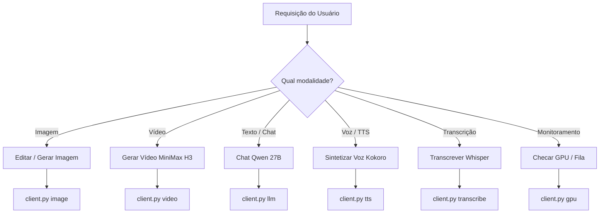

# QwenSwarm AI Suite API Skill

This skill provides step-by-step procedures and tools to control the **QwenSwarm Unified AI Server** (`http://192.168.2.183:3000`), which unifies Image, Video, LLM, TTS, and Speech-to-Text with automatic GPU arbitration (pauses/resumes the image queue during on-demand compute).

## 🚀 Quick Execution (CLI Client)

A pre-built CLI helper is available at:
`[client.py](./scripts/client.py)`

You can run any capability in a single shell command:

```bash
# 1. Telemetria e VRAM da GPU
.agents/skills/qwenswarm-api/scripts/client.py gpu

# 2. Resumo da Fila de Imagens
.agents/skills/qwenswarm-api/scripts/client.py queue status

# 3. Geração / Edição de Imagem Prioritária
.agents/skills/qwenswarm-api/scripts/client.py image --prompt "change dress to red silk" --image photo.jpg --out result.png

# 4. Geração de Vídeo (Pausa a fila, gera o vídeo e retoma)
.agents/skills/qwenswarm-api/scripts/client.py video --prompt "cinematic drone flight over tropical beach" --seconds 4 --out video.mp4

# 5. Chat com LLM Qwen 3.8 27B (Uncensored)
.agents/skills/qwenswarm-api/scripts/client.py llm --prompt "Aprimore este prompt para imagem fotorrealista: mulher caminhando na praia"

# 6. Síntese de Voz (Kokoro TTS <1s)
.agents/skills/qwenswarm-api/scripts/client.py tts --text "Olá! Bem-vindo ao QwenSwarm Studio." --voice pf_dora --out speech.wav

# 7. Transcrição de Áudio (Whisper)
.agents/skills/qwenswarm-api/scripts/client.py transcribe --file speech.wav --verbose
```

---

## 📡 HTTP Endpoints Reference (`http://192.168.2.183:3000`)

### 1. ⚙️ GPU Arbiter & Telemetria
- `GET /api/system/gpu`
  - Retorna estado do Arbiter (`qwen`, `video`, `llm`), VRAM alocada (`vram_used_mb`, `vram_total_mb`), utilização e temperatura.
- `POST /api/system/gpu/action`
  - Body: `{"action": "pause" | "resume" | "free" | "release_llm"}`

### 2. 🎨 Imagem (Qwen 2.1)
- `POST /api/edit`
  - Edição imediata no topo da fila.
  - Body JSON:
    ```json
    {
      "prompt": "keep person, wear black leather jacket",
      "image_base64": "<base64>",
      "model": "qwen21_pruna",
      "resolution": 768
    }
    ```
  - Retorna `{"id": "...", "status": "pending", "status_url": "/api/edit/{id}"}`.
- `GET /api/edit/{id}` — Polling de status (`pending`, `running`, `done`, `error`).
- `GET /api/edit/{id}/image` — Download binário PNG da imagem gerada.
- `GET /api/queue` — Status da fila.
- `POST /api/queue/pause|resume|cancel` — Controle da fila.

### 3. 🎬 Vídeo (MiniMax H3 / FastVideo Trim 8-step)
- `POST /api/video/generate`
  - Aciona o Arbiter (pausa fila de imagens, limpa VRAM, renderiza vídeo e retoma a fila ao concluir).
  - Body JSON:
    ```json
    {
      "prompt": "cinematic shot of sunset over ocean",
      "mode": "t2v",
      "size": "preview",
      "seconds": 3,
      "seed": -1
    }
    ```
  - Retorna: `{"ok": true, "job_id": "...", "status": "queued"}`.
- `GET /api/video/job/{id}` — Polling (`waiting_gpu`, `running`, `done`, `error`).
- `GET /api/video/gallery` — Lista os vídeos gerados.
- `GET /api/video/file/{filename}` — Download/Streaming do vídeo MP4.
- `DELETE /api/video/file/{filename}` — Exclusão do vídeo.

### 4. 💬 LLM (Qwen 3.8 27B Uncensored)
- `POST /api/llm/chat`
  - Formato compatível com OpenAI:
    ```json
    {
      "messages": [{"role": "user", "content": "Seu prompt aqui"}],
      "system_prompt": "Instruções do sistema",
      "temperature": 0.7,
      "max_tokens": 1024
    }
    ```
- `POST /api/llm/release`
  - Libera a GPU imediatamente e retoma a fila de imagens.

### 5. 🎙️ Voz (Kokoro-82M TTS)
- `POST /api/tts`
  - Body JSON: `{"text": "Frase para falar", "voice": "pf_dora", "speed": 1.0}`
  - Vozes disponíveis: `pf_dora`, `pm_alex`, `pm_santa` (PT-BR); `af_heart`, `am_adam` (EN-US).
  - Retorna: Binário direto `audio/wav`.
- `GET /api/tts/voices` — Lista de vozes.

### 6. 📝 Transcrição (Whisper STT)
- `POST /api/transcribe`
  - Aceita Multipart (`audio` / `file`) ou JSON (`{"audio_base64": "...", "lang": "pt"}`).
  - Retorna: `{"ok": true, "text": "...", "language": "pt", "segments": [...]}`.

---

## 💡 Fluxo de Decisão do Agente



1. **Ao gerar vídeo ou usar LLM**: Saiba que o servidor pausa a fila de imagens temporariamente para garantir que a RTX 3060 não sofra OOM. Assim que a tarefa termina, a fila de imagens é retomada sem perda de dados.
2. **Ao transcrever ou sintetizar voz**: O impacto em VRAM é desprezível e responde em menos de 1 segundo.
