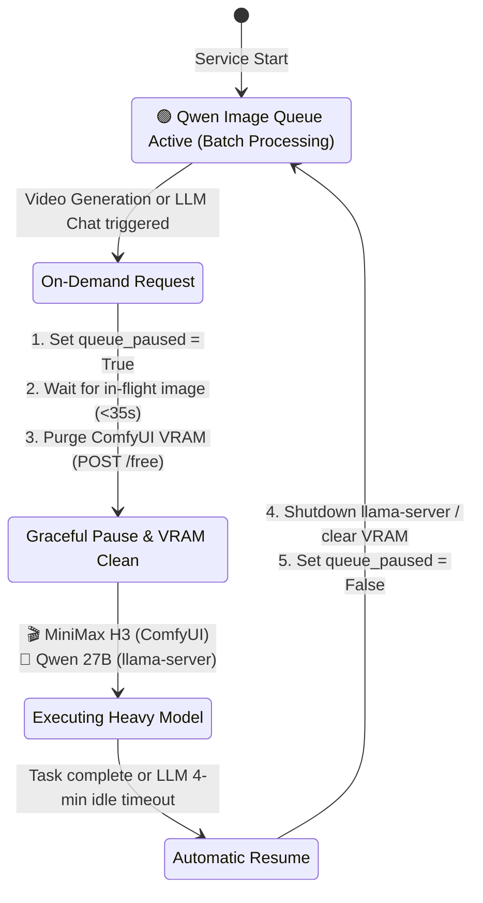

# QwenSwarm: Unified Multi-Modal AI Suite & Distributed GPU Cluster

A production-grade, distributed AI studio powered by **ComfyUI**, **Qwen Image 2.1**, **MiniMax H3 / FastVideo**, **Qwen 3.8 27B LLM**, **Kokoro TTS**, and **Whisper STT**. Built for high-throughput batch generation, priority editing, seamless multi-modal creation, and automated GPU arbitration across heterogeneous hardware.

---

## Architecture Overview

```
                      ┌──────────────────────────────────────────────┐
                      │              Web UI & AI Agents              │
                      │  • Unified Multi-Studio SPA (Port :3000)     │
                      │  • Agentic Skill & CLI (qwenswarm-api)       │
                      └──────────────────────┬───────────────────────┘
                                             │ HTTP :3000
                                             ▼
                      ┌──────────────────────────────────────────────┐
                      │          MASTER SERVER (qwen-editor)         │
                      │  • Automated GPU Arbiter (Auto-Pause/Resume) │
                      │  • Persistent Queue (queue.json >130k items) │
                      │  • Image Pool & Video Gallery Management     │
                      │  • Satellite Cluster Lease Coordinator       │
                      └──────┬───────────────┬───────────────┬───────┘
                             │               │               │
            ┌────────────────┴──────┐        │               └────────────────┐
            │ GPU Arbitration       │        │ Subprocess / Sidecar           │ Cluster Leases
            ▼                       ▼        ▼                                ▼
┌───────────────────────┐ ┌───────────────┐ ┌───────────────────┐ ┌───────────────────────┐
│     ComfyUI Engine    │ │  llama-server │ │ Kokoro & Whisper  │ │ SATELLITE NODES       │
│ • Qwen Image 2.1      │ │ • Qwen 3.8    │ │ • Kokoro-82M TTS  │ │ • Laptop / Worker GPU │
│   (GGUF + Pruna LoRA) │ │   27B Hauhau  │ │   (<1s audio/wav) │ │ • Autonomous offline  │
│ • MiniMax H3 / FastH3 │ │   (FastMTP    │ │ • Whisper.cpp STT │ │   outbox buffer       │
│   (T2V & I2V + Audio) │ │   Speculative)│ │   (CUDA small)    │ │ • Local ComfyUI       │
└───────────────────────┘ └───────────────┘ └───────────────────┘ └───────────────────────┘
```

The system unifies five major generative AI engines on a single master machine with low-overhead GPU arbitration:
- **🎨 Image Studio (Qwen 2.1)**: High-throughput batch queue (>130k items) and real-time single-image priority editing.
- **🎬 Video Studio (MiniMax H3 / FastVideo)**: Text-to-Video and Image-to-Video generation (8-step) with synchronized audio.
- **💬 LLM Studio (Qwen 3.8 27B Uncensored)**: Conversational chat and prompt engineering via `llama.cpp` with FastMTP speculative decoding.
- **🎙️ Voice Studio (Kokoro-82M TTS)**: Neural voice synthesis in Brazilian Portuguese and English in <1 second per clip.
- **📝 Transcription Studio (Whisper.cpp)**: Fast audio transcription and subtitle alignment with automatic language detection.
- **⚡ Automated GPU Arbiter**: Manages single-GPU constraints (RTX 3060 12GB). When Video or LLM generation starts, it pauses the continuous background image queue, purges ComfyUI VRAM, runs the heavy task, and automatically resumes the queue upon completion.
- **🌐 Distributed Cluster**: Remote worker nodes (e.g. RTX 3060 6GB Laptop) pull leased blocks of tasks via API, rendering in parallel with local offline buffering (`outbox/`).

---

## Automated GPU Arbiter (Queue Auto-Pause & Resume)

Consumer GPUs (such as the RTX 3060 12GB) cannot run multiple heavy generative models concurrently without CUDA Out Of Memory (OOM) errors. The `GPUArbiter` coordinates access:



- **Zero Compute Wasted**: Current in-flight image rendering finishes cleanly before GPU ownership transfers.
- **Satellite Immunity**: Secondary worker nodes continue rendering on their own hardware uninterrupted while the Master GPU is paused.
- **Idle Timeout**: If an interactive LLM chat session is left open without messages for 4 minutes, the server terminates `llama-server` and resumes image rendering automatically.

---

## Models & AI Capabilities Installed

### 1. 🖼️ Image Generation & Editing
- `diffusion_models/qwen-image-2.1-UC-Q4_K_M.gguf` (~4.3 GB)
- `diffusion_models/qwen-rapid-nsfw-v9.0-Q3_K_S.gguf` (~3.8 GB)
- `loras/p_qwen_image_2.1_8step_v0.1.safetensors` (Pruna 8-step acceleration)
- `text_encoders/qwen3vl_8b_int8_convrot.safetensors` (~8.8 GB)
- `text_encoders/Qwen2.5-VL-7B-Instruct-abliterated.Q4_K_M.gguf` + `mmproj-Q8_0.gguf`
- `vae/qwen_image_2.1_vae_bf16.safetensors`

### 2. 🎬 Video Generation (Text/Image-to-Video + Audio)
- `diffusion_models/fastvideo_fasth3_8step_v2_pruned_int8_convrot.safetensors`
- `diffusion_models/minimax_h3_fl2va_pruned_int8_convrot.safetensors`
- `text_encoders/qwen3vl_32b_minimax_h3_nvfp4_awq.safetensors` & `int8_convrot`
- `loras/minimax_h3_fl2v_turbo_8step_v1.0_comfyui_bf16.safetensors`
- `vae/minimax_h3_video_vae_int8_convrot.safetensors` & `fp16`
- `vae/minimax_h3_audio_vae_fp32.safetensors` (synchronized video audio)

### 3. 🧠 Large Language Model (LLM)
- `models/Qwen3.8-27B-Uncensored-HauhauCS-Aggressive-IQ2_M.gguf` (~10.3 GB)
- `models/Qwen3.8-27B-Uncensored-HauhauCS-Aggressive-FastMTP-32K.gguf` (~900 MB draft model)
- Engine: Custom-built `llama.cpp` (`llama-server`) with Flash-Attention & Speculative Decoding.

### 4. 🎙️ Neural Voice (TTS) & Speech-to-Text (STT)
- **Kokoro-82M**: `hexgrad/Kokoro-82M` via FastAPI sidecar (supports Portuguese `pf_dora`, `pm_alex`, `pm_santa` and English `af_heart`, etc.).
- **Whisper.cpp**: `ggml-small.bin` with CUDA acceleration for automatic speech recognition and subtitle timestamps.

---

## 🤖 Agentic Skill (`qwenswarm-api`) & CLI Client

The repository includes a ready-to-use skill and command-line client for AI Agents (such as Antigravity / Gemini CLI) and headless scripts:

Location: [`.agents/skills/qwenswarm-api/scripts/client.py`](.agents/skills/qwenswarm-api/scripts/client.py)

```bash
# Check GPU VRAM and Arbiter Status
.agents/skills/qwenswarm-api/scripts/client.py gpu

# Check active batch queue summary
.agents/skills/qwenswarm-api/scripts/client.py queue status

# Priority image edit
.agents/skills/qwenswarm-api/scripts/client.py image \
  --prompt "change dress to red silk" \
  --image input.jpg \
  --out result.png

# Generate a 4-second video (auto-pauses queue and resumes when done)
.agents/skills/qwenswarm-api/scripts/client.py video \
  --prompt "cinematic drone shot over ocean waves at sunset" \
  --seconds 4 \
  --out video.mp4

# Chat or prompt enhancement with Qwen 27B LLM
.agents/skills/qwenswarm-api/scripts/client.py llm \
  --prompt "Aprimore este prompt para imagem fotorrealista: mulher caminhando na praia"

# Fast voice synthesis (<1s)
.agents/skills/qwenswarm-api/scripts/client.py tts \
  --text "Olá! O cluster QwenSwarm está totalmente operacional." \
  --voice pf_dora \
  --out speech.wav

# Transcribe audio with Whisper
.agents/skills/qwenswarm-api/scripts/client.py transcribe \
  --file speech.wav \
  --verbose
```

---

## Complete API Reference (`http://192.168.2.183:3000`)

### 🎨 Image Studio
| Endpoint | Method | Description |
| :--- | :--- | :--- |
| `/api/edit` | `POST` | Priority image edit (highest queue priority). Accepts JSON or multipart. |
| `/api/edit/{id}` | `GET` | Poll execution status (`pending`, `running`, `done`, `error`). |
| `/api/edit/{id}/image`| `GET` | Direct binary download of the generated PNG. |
| `/api/edit/{id}` | `DELETE` | Cancels pending task or removes output file, metadata, and queue entry. |
| `/api/batch` | `POST` | Enqueues pool images × presets with guardrails. |
| `/api/pool` | `GET/POST` | List or upload images to the persistent pool. |
| `/api/queue` | `GET` | Windowed queue summary (running, pending, leased, done). |
| `/api/queue/pause` | `POST` | Manually pauses the queue. |
| `/api/queue/resume` | `POST` | Resumes queue processing. |
| `/api/worker/lease` | `POST` | Leases tasks to authenticated satellite workers. |
| `/api/worker/complete`| `POST` | Receives completed image and metadata from satellite workers. |

### 🎬 Video Studio
| Endpoint | Method | Description |
| :--- | :--- | :--- |
| `/api/video/status` | `GET` | Checks readiness of video diffusion UNet, CLIP, and VAEs. |
| `/api/video/generate` | `POST` | Triggers T2V or I2V video generation (pauses image queue automatically). |
| `/api/video/job/{id}` | `GET` | Polls video job status and result video URL. |
| `/api/video/gallery` | `GET` | Lists all generated `.mp4` video files with metadata. |
| `/api/video/file/{fn}`| `GET` | Streams video file with HTTP Range support. |
| `/api/video/file/{fn}`| `DELETE` | Permanently deletes a generated video file. |

### 💬 LLM Studio
| Endpoint | Method | Description |
| :--- | :--- | :--- |
| `/api/llm/status` | `GET` | Returns GPU Arbiter state, model details, and idle timeout status. |
| `/api/llm/chat` | `POST` | OpenAI-compatible chat completion. Purges ComfyUI VRAM and pauses image queue. |
| `/api/llm/release` | `POST` | Manually shuts down `llama-server` and resumes the image queue immediately. |

### 🎙️ Voice & Audio (TTS / STT)
| Endpoint | Method | Description |
| :--- | :--- | :--- |
| `/api/tts/voices` | `GET` | Lists available neural voices (PT-BR and EN-US). |
| `/api/tts` | `POST` | Synthesizes speech returning raw WAV audio in <1 second. |
| `/api/transcribe/status`| `GET` | Checks Whisper model availability and supported languages. |
| `/api/transcribe` | `POST` | Transcribes audio/video files via Whisper.cpp (accepts multipart or JSON). |

### ⚙️ System & GPU Telemetry
| Endpoint | Method | Description |
| :--- | :--- | :--- |
| `/api/system/gpu` | `GET` | Live telemetry (`vram_used_mb`, `vram_total_mb`, `gpu_util_pct`, `temperature_c`, `mode`). |
| `/api/system/gpu/action`| `POST` | Manual actions (`pause`, `resume`, `free`, `release_llm`). |

---

## Getting Started

### Master Server Setup
```bash
# 1. Start ComfyUI
python main.py --listen 127.0.0.1 --port 8188

# 2. Start QwenSwarm Master Studio
cd qwen-editor
python app.py
```
Web Dashboard will be live at `http://<MASTER_IP>:3000`.

### Satellite Worker Setup
```bash
cd satellite-worker
export MASTER_URL="http://192.168.2.183:3000"
export WORKER_ID="predator-3060"
export BATCH_SIZE=15
python worker.py
```

---

## License

This project is licensed under the MIT License - see the [LICENSE](LICENSE) file for details.
